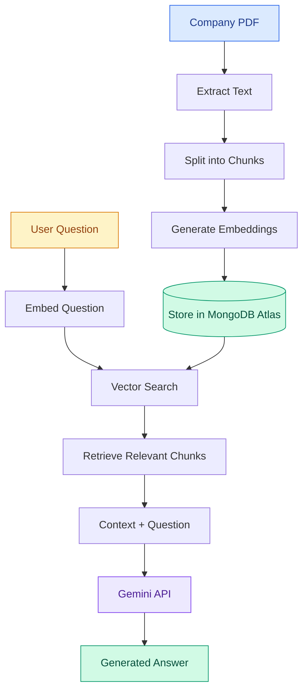

# RAG Chatbot using MongoDB Atlas and Gemini

A Retrieval-Augmented Generation (RAG) chatbot that retrieves relevant information from a company PDF using MongoDB Atlas Vector Search and generates answers using Google's Gemini API.

## Tech Stack

- **Node.js** – Backend
- **Google Gemini API** – Embeddings and answer generation
- **MongoDB Atlas** – Vector storage and similarity search
- **JavaScript** – Application logic

## RAG Pipeline



## How It Works

1. Extract text from the company PDF.
2. Split the text into smaller chunks.
3. Generate an embedding vector for each chunk.
4. Store the chunks and embeddings in MongoDB Atlas.
5. Convert the user's question into an embedding.
6. Search MongoDB Atlas for semantically relevant chunks.
7. Send the retrieved context and question to Gemini.
8. Return the generated answer to the user.

## Project Structure

```text
RAG/
├── base.js
├── chunk.js
├── embedding.js
├── mongodb.js
├── store.js
├── search.js
├── answer.js
├── main.js
├── sample_company_details_rag.pdf
├── .env
├── .gitignore
└── README.md
```

## Setup and Run

### 1. Install dependencies

```bash
npm install
```

### 2. Configure environment variables

Create a `.env` file:

```env
Gemini_Key=your_gemini_api_key
MongoDB=your_mongodb_atlas_connection_string
```

### 3. Ingest the PDF

```bash
node base.js
```

This extracts the PDF text, splits it into chunks, generates embeddings, and stores them in MongoDB Atlas.

### 4. Start the chatbot

```bash
node main.js
```

Enter a question about the company and receive an answer based on the retrieved context.

## Key Features

- PDF-based knowledge retrieval
- Text chunking and embedding generation
- MongoDB Atlas Vector Search
- Context-based answer generation with Gemini
- Terminal-based question-and-answer interface

## Security

Never commit your `.env` file or expose API keys and database credentials.
